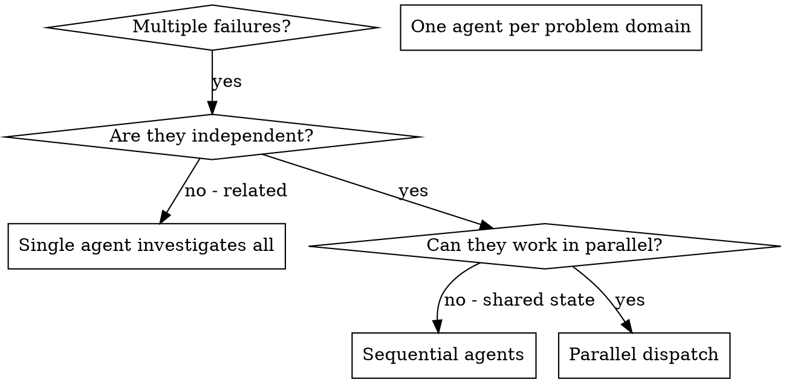

# 派遣并行代理

## 概述

你将任务委托给具有隔离上下文的专门代理。通过精确构建它们的指令和上下文，你确保它们保持专注并成功完成任务。它们永远不应继承你会话的上下文或历史——你精确构建它们所需的一切。这也为你自己的协调工作保留了上下文。

当你有多个不相关的失败（不同的测试文件、不同的子系统、不同的 bug）时，顺序调查会浪费时间。每次调查都是独立的，可以并行进行。

**核心原则：** 为每个独立问题域派遣一个代理。让它们并发工作。

## 何时使用



**使用时机：**
- 3 个以上测试文件因不同根本原因失败
- 多个子系统独立损坏
- 每个问题可以在没有其他人上下文的情况下理解
- 调查之间没有共享状态

**不要使用时机：**
- 失败是相关的（修复一个可能修复其他）
- 需要理解完整系统状态
- 代理会相互干扰

## 模式

### 1. 识别独立域

按损坏内容对失败分组：
- 文件 A 测试：工具审批流
- 文件 B 测试：批量完成行为
- 文件 C 测试：中止功能

每个域是独立的——修复工具审批不影响中止测试。

### 2. 创建聚焦的代理任务

每个代理获得：
- **具体范围：** 一个测试文件或子系统
- **清晰目标：** 让这些测试通过
- **约束：** 不要更改其他代码

### 3. 并行派遣

在同一响应中发出所有三个子代理派遣——它们并行运行：

```text
子代理（通用）："修复 agent-tool-abort.test.ts 失败"
子代理（通用）："修复 batch-completion-behavior.test.ts 失败"
子代理（通用）："修复 tool-approval-race-conditions.test.ts 失败"
# 所有三个并发运行。
```

一个响应中的多个派遣调用 = 并行执行。每个响应一个 = 顺序执行。

### 4. 整合

当代理返回时：
- 运行完整测试套件，确认所有修复能协同工作
- 整合所有改动

## 代理提示词结构

好的代理提示词：
1. **聚焦** - 一个清晰的问题域
2. **自包含** - 理解问题所需的所有上下文
3. **不做多余要求** - 不要求代理审查或写总结，让它专注完成修复

```markdown
修复 src/agents/agent-tool-abort.test.ts 中的 3 个失败测试：

1. "should abort tool with partial output capture" - 期望消息中包含 'interrupted at'
2. "should handle mixed completed and aborted tools" - 快速工具被中止而不是完成
3. "should properly track pendingToolCount" - 期望 3 个结果但得到 0

这些是时序/竞态条件问题。你的任务：

1. 阅读测试文件并理解每个测试验证什么
2. 识别根本原因——时序问题还是实际 bug？
3. 修复方法：
   - 用基于事件的等待替换任意超时
   - 如果发现中止实现中的 bug 则修复
   - 如果测试行为已更改则调整测试期望

不要只增加超时——找到真正的问题。
```

## 常见错误

**❌ 太宽泛：** "修复所有测试" - 代理迷失
**✅ 具体：** "修复 agent-tool-abort.test.ts" - 聚焦范围

**❌ 没有上下文：** "修复竞态条件" - 代理不知道在哪里
**✅ 有上下文：** 粘贴错误消息和测试名称

**❌ 没有约束：** 代理可能重构所有内容
**✅ 有约束：** "不要更改生产代码"或"只修复测试"

**❌ 要总结：** 让代理写一份"你发现了什么、修复了什么"的总结——它会把注意力从修复转到写报告，且那份总结你还得自己去核对
**✅ 只要修复：** 让它完成修复并收束汇报；用测试套件验证结果，而不是靠它的自述

## 何时不使用

**相关失败：** 修复一个可能修复其他——先一起调查
**需要完整上下文：** 理解需要看到整个系统
**探索性调试：** 你还不知道什么坏了
**共享状态：** 代理会干扰（编辑相同文件、使用相同资源）

## 会话中的真实示例

**场景：** 重大重构后 3 个文件中的 6 个测试失败

**失败：**
- agent-tool-abort.test.ts：3 个失败（时序问题）
- batch-completion-behavior.test.ts：2 个失败（工具未执行）
- tool-approval-race-conditions.test.ts：1 个失败（执行计数 = 0）

**决策：** 独立域——中止逻辑独立于批量完成独立于竞态条件

**派遣：**
```
代理 1 → 修复 agent-tool-abort.test.ts
代理 2 → 修复 batch-completion-behavior.test.ts
代理 3 → 修复 tool-approval-race-conditions.test.ts
```

**结果：**
- 代理 1：用基于事件的等待替换超时
- 代理 2：修复事件结构 bug（threadId 位置错误）
- 代理 3：添加等待异步工具执行完成

**集成：** 所有修复独立，无冲突，完整套件通过

## 验证

代理返回后：
1. **检查冲突** - 代理是否编辑了相同代码？
2. **运行完整套件** - 验证所有修复一起工作
3. **抽查** - 代理可能犯系统性错误