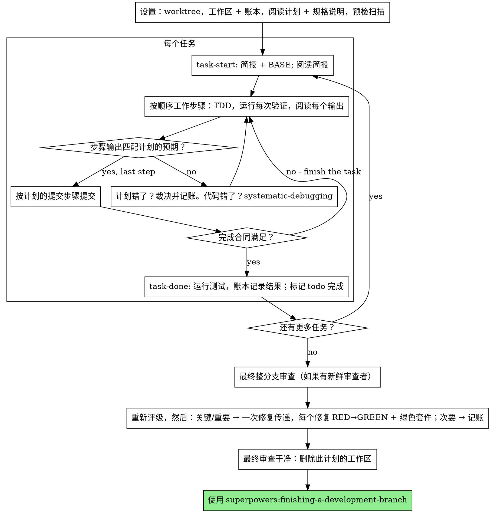

# 执行计划

你在本会话中自己逐任务执行计划：没有每个任务的实施子代理，没有每个任务的审查者。最后对整个分支进行一次新鲜上下文的审查。

**为什么内联：** 子代理驱动开发为每个任务支付一个新鲜实施者和一个新鲜审查者的成本，每个都从零开始重新阅读代码库。内联执行为一个上下文（你的）加上最后的一个审查者付费。它放弃的是每个任务的新鲜上下文和每个任务的第二双眼睛。本技能通过其他方式保留那两样东西买到的东西：简报是规格说明，账本是你的记忆，TDD 是每个任务的关卡，最终审查者是第二双眼睛。

**核心原则：** 计划已经完成了思考。精确执行它，用你看着失败然后通过的测试证明每个步骤，并留下能经受你自己遗忘的记录。

**叙述：** 在工具调用之间，最多叙述一行简短的话——账本和工具结果承载记录。

**持续执行：** 不要在任务之间暂停与你的（人类）搭档确认。他们选择内联执行是为了花更少的时间，而不是在每个任务后回答"我应该继续吗？"。执行计划中的所有任务，不要停止。

**裁决，而不是停滞。** 冲突、歧义、计划缺陷——决定它们。规格说明是具有约束力的权威，计划是它的论证，你的判断解决两者都无法回答的问题。将每个决定记录在账本中，格式为 `Ruling: <你决定了什么> — <为什么> — <如果错了的代价>`，然后继续。没有账本裁决而偏离计划是秘密做出的决定。

只有四件事能让你停下来，且只有这四件：不可逆或破坏性操作；安全敏感操作；此 worktree 之外且规范要求你先询问的副作用（合并、推送到共享分支、发布）；以及计划如此破碎以至于每条前进路径都是猜测。对于这些，停下来询问。

## 何时使用

- 你有一个来自 superpowers:writing-plans 的计划，且你的（人类）搭档在交接时选择了内联执行。
- 你的 harness 没有子代理工具（参见 `../using-superpowers/references/` 中每个平台的参考）。永远不要伪造派遣；在这里运行计划。
- 任务 mostly 独立——与 superpowers:subagent-driven-development 相同的前提条件。

一个完全指定的计划使内联执行成为转录加测试：它在中级会话模型上运行良好，而最有能力的模型赚取其成本的一个地方是最终审查，本技能会单独派遣它。当他们选择内联时告诉你的（人类）搭档这一点。

当你的（人类）搭档想要每个任务的审查关卡，或计划足够长以至于其后面的任务会在压缩的上下文上运行时，优先使用 superpowers:subagent-driven-development。长计划上的内联执行仍然有效——账本使其可恢复——但最后的任务得到的你最少的你。

## 流程

## 设置

确保工作在隔离的工作区中进行：使用 superpowers:using-git-worktrees 创建一个或验证现有的。永远不要在未经你的（人类）搭档明确同意的情况下在 main/master 分支上开始实施。

对话记忆无法在压缩中存活。丢失位置的内联执行者会重新实施提交已存在的任务——与控制器重新派遣它们相同的失败，以你自己的上下文为代价。在账本文件中跟踪进度，而不仅仅是在 todos 中。Harness todos 是实时视图；账本是记录。

工作区和账本与 superpowers:subagent-driven-development 共享——相同目录，相同格式——所以计划可以在飞行中更改执行者，新的执行者从同一个账本恢复。

- 每个计划拥有一个工作区：在技能启动时，运行 `../subagent-driven-development/scripts/sdd-workspace PLAN_FILE`——它打印计划的 git 忽略目录（`<repo-root>/.superpowers/sdd/<plan-basename>/`），是本计划所有工件的家：账本、简报、审查包。其他计划的目录永远不是你可以读写的。
- 在 `<workspace>/progress.md` 检查此计划的账本。如果其第一行命名了你的计划文件，带有 `Task <N>: complete` 行的任务是完成的——不要重做它们；在第一个没有该行的任务处恢复。即使你的上下文不再记得制作它们，它们的提交也存在于 git 中：压缩后，信任账本和 `git log` 胜过你自己的回忆。第一行命名不同计划文件的账本是另一个计划的进度：离开它并开始你自己的，全新的。
- 创建账本，其身份作为第一行：`# SDD ledger — plan: <计划文件路径>`。
- `git clean -fdx` 会破坏工作区（它是 git 忽略的临时文件）；如果发生，从 `git log` 恢复。

阅读计划一次，注意其上下文和全局约束，并为每个任务创建一个 todo。如果计划命名了规格说明，也阅读它：规格说明是计划论证的权威，计划内部的冲突以其为准解决。没有可达规格说明的计划会获得一个账本说明——没有它的裁决是临时的。

**必需的子技能：** 现在加载 superpowers:test-driven-development，在任务 1 之前。它管理下面每个任务的每个步骤；步骤已经说"先写失败测试"的计划不能免除你阅读它。

在任务 1 之前，扫描计划以查找任务之间的冲突。计划的 Interfaces 块告诉你在哪里查找：对于每个消费早期任务产出的任务，一行账本——两个任务，一个产出对另一个消费，以及你发现的。什么都不共享的任务没有行；任务什么都不共享的计划获得单行 `Pre-flight: no shared interfaces`。用规格说明作为约束权威对每行表面上的冲突进行裁决，将裁决记录在其行旁边，然后开始任务 1。每个任务自己的文本在你阅读其简报时检查，不是在这里。

## 任务循环

你打印的所有内容，以及每个工具结果，都会在会话的其余时间内驻留在你的上下文中。将长测试输出重定向到工作区中的文件并读取其尾部；阅读简报，而不是整个计划。

### 1. 接受任务

- 运行此技能的 `scripts/task-start PLAN_FILE N`。它在一个调用中打印简报路径和 BASE（任务范围切割自的提交）。阅读每个任务的简报，包括你在设置中记得的任务：你记得的是摘要，简报有确切的值、签名和测试用例。
- 标记任务的 todo in_progress。

每个工具调用都是一个重新读取你整个上下文的轮次。簿记与工作一起运行——账本附加在与提交相同的调用中，永远不在自己的调用中。

### 2. 工作步骤

计划的步骤已经是 RED-GREEN 顺序；在 superpowers:test-driven-development 下按该顺序跟随它们，在设置时加载。测试步骤的代码首先写入并首先运行。看着它失败是一个步骤，不是形式——在实现存在之前通过的测试是关于测试的发现。

运行命令的每个步骤都有一个 `Expected:` 行。运行命令，读取其输出，并比较。三种结果：

- **匹配。** 下一步。
- **代码错了。** 使用 superpowers:systematic-debugging。找到原因；永远不要修补症状以使步骤输出匹配。
- **计划错了**——步骤与规格说明矛盾，早期任务的接口与此任务消费的不匹配，无法工作的命令。对满足规格说明的最小更改进行裁决，将其作为 `Task <N>: Ruling: <发现> — <你决定了什么和为什么>` 记入账本，然后继续。裁决被携带，不是被记住：触及相同接口的后续任务从账本读取它。

按计划的提交步骤提交。跨越几个提交的任务是可以的；BASE 是审查范围切割自的，永远不是 `HEAD~1`。

### 3. 完成合同

在任务的账本行之前，以下所有内容都是真实的，在本会话中有证据——不是从 diff 看起来正确推断的：

- 简报命名的每个测试都存在并在本任务中运行，且你读取了输出。
- 任务的最终测试运行通过——`task-done` 是该运行，它将命令和结果写入账本行。
- 简报中的每个 `Expected:` 行都与真实输出进行了比较。
- 与简报的每个偏差都有账本中的 `Ruling:` 行。

**必需的子技能：** superpowers:verification-before-completion 管理该声明。如果任何项目缺失，任务未完成：完成它。

### 4. 完成任务

运行此技能的 `scripts/task-done PLAN_FILE N BASE -- <测试命令>`，使用简报为整个任务命名的测试命令。它运行测试，将完整输出保留在工作区中，打印尾部，并且——只有当它们通过时——将完成行附加到账本：

`Task <N>: complete (commits <base7>..<head7>, tests: <命令> → <结果>)`

失败的运行不记录任何内容；任务未完成。当它记录时，标记 todo 完成并接受下一个任务。

## 最终审查

运行 `../subagent-driven-development/scripts/review-package PLAN_FILE MERGE_BASE HEAD`（MERGE_BASE = 分支开始自的提交，例如 `git merge-base main HEAD`）并从其打印的文件审查。

**有子代理工具时：** 在最有能力的可用模型上派遣审查者——整分支审查是判断任务——使用 superpowers:requesting-code-review 的 [code-reviewer.md](../requesting-code-review/code-reviewer.md)，带有包路径、计划和规格说明路径、计划的 Review Focus 部分逐字（如果有的话）（计划的测试未锻炼的输入类和失败模式——审查者故意检查每个），以及指向账本 `Ruling:` 行的指针，以便它可以权衡你做出的调用。明确指定模型；省略的模型继承会话的，可能不是最有能力的。这是整个运行买到的一个新鲜上下文。不要跳过它，不要用你自己的 diff 阅读替换它。

**没有子代理工具时：** 阅读 code-reviewer.md 并在最后一个任务的账本行之后作为单独的传递自己对包执行该审查。将 `Final review: self-review (no subagent tool)` 写入账本，并在你的最终消息中这样说：作者的自我审查比新鲜审查者弱，你的（人类）搭档决定这在合并之前是否足够。

在你采取任何行动之前对发现进行排序。审查者的严重性标签是建议；关卡是你的。其"Declined to judge"列表也是你的：那里的每一行都是你做出并记账的裁决，完全像计划冲突——`Final: Ruling: <审查者搁置的行为> — <合理使用此软件的人得到的，以及为什么那成立或为什么现在是发现> — <如果错了的代价>`。首先重新评级，按效果：规格说明是愿景文档，发现的评级是合理使用此软件的人如果发布会得到的，不是规格说明是否命名了触发它的输入——因为规格说明沉默而将发现设为次要的审查者已经评级了规格说明，不是效果。然后：

- **关键和重要** 进入修复传递。
- **次要** 进入账本，格式为 `Final: minor (deferred): <一行>` 并进入你的最终消息的"Deferred minors"下。次要永远不进入修复传递，永远不成为裁决——裁求是关于冲突的决定，不是关于你拒绝打磨建议的说明。

自己修复关键和重要的发现——你是这里的实施者——在一次传递中。每个修复由 TDD 验证，不是由第二个审查者：编写重现发现的测试，看着它失败，使其通过，然后运行整个套件。将每个记录在账本中，格式为 `Final: fixed <发现> — <测试名称> RED→GREEN, suite <N>/<N>`。没有首先失败的测试的修复未经验证；传递后套件不是绿色意味着传递未结束。不要派遣重新审查：它会重新阅读 diff，其覆盖测试已经回答"已解决"，其套件运行已经回答"没有破坏任何东西"。

你决定不修复的发现是裁决——`Final: Ruling: <发现> — <为什么代码成立> — <如果错了的代价>`——并进入裁决列表到达你的（人类）搭档。没有第二次修复传递。

## 完成

在删除任何内容之前，将每个包含 `Ruling:` 的账本行收集到你的最终消息的"Rulings I made"下，按你做出的顺序，每个带有如果错了的代价，以及每个 `minor (deferred)` 行在"Deferred minors"下。两个列表都是详尽的。你的最终消息是你代表你的（人类）搭档做出的决定——以及你选择不采取行动的发现——到达他们的唯一地方。

当最终审查干净且其修复已提交时，删除此计划的工作区目录——git 历史现在是记录。兄弟目录属于其他计划；不要动它们。

使用 superpowers:finishing-a-development-branch。

## 常见合理化

| 借口 | 现实 |
|------|------|
| "我记得任务 N 说什么" | 你记得的是摘要。简报有确切的值。阅读它。 |
| "计划的代码是对的，跳过看着测试失败" | 你从未看着失败的测试证明不了任何东西。这是一个步骤。运行它。 |
| "我会在最后运行完整套件而不是每步" | 每步运行是你学习哪步破坏它的方式。任务结束运行是合同，不是替代品。 |
| "计划在这里错了，我就做正确的事" | 做正确的事并将裁决记账。未记账的偏离是秘密做出的决定。 |
| "我会在几个任务后写账本行" | 压缩不会等待方便的时刻。每个任务一行，在与提交相同的消息中。 |
| "让我在下一个任务之前确认" | 他们选择内联是为了花更少。进度提示反而花他们的时间。只有四个停止能停止你。 |
| "我仔细阅读了自己的 diff；最终审查是多余的" | 同一作者，同一盲点。审查者是这次运行买到的唯一新鲜上下文。 |
| "测试应该通过，改动是平凡的" | "应该"不是证据。合同需要命令及其输出。 |
| "子代理慢且贵，我也跳过最终审查" | 内联已经移除了每任务审查者。整个分支的一次审查是地板，不是天花板。 |
| "审查者说次要，所以是次要" | 标签评级了规格说明的沉默。评级人得到的。重新评级，然后关卡。 |
| "修复很明显，不需要先失败测试" | 失败测试是发现是真实且现在消失的唯一证明。没有它你只有 diff 和希望。 |
| "我会在里面时也修复次要" | 你修复的每个次要都是你的搭档没有要求的测试、修复和套件运行。将它们记账；你的搭档决定。 |