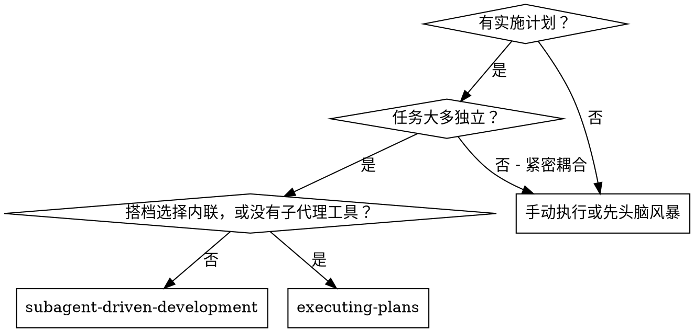
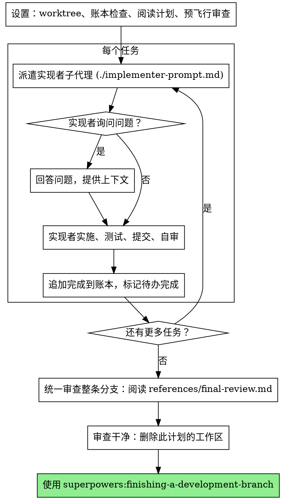

# 子代理驱动开发

执行计划的方式是：每个任务派遣一个全新的实现者子代理，由实现者实现、测试、提交并自审；**所有任务执行完成之后**，才对整条分支做一次统一的整体审查（规格符合性 + 代码质量）并修复其发现。

**为什么使用子代理：** 你将任务委派给具有隔离上下文的专用代理。通过精确构建它们的指令和上下文，你确保它们保持专注并成功完成任务。它们永远不应该继承你的会话上下文或历史——你为它们构建恰好所需的内容。这也为你自己的协调工作保留了上下文。

**核心原则：** 每个任务新鲜子代理 + 实现者自审 + 所有任务完成后的统一审查 = 高质量，快速迭代

**叙述：** 在工具调用之间，最多叙述一行简短的内容——账本和工具结果携带记录。

**持续执行：** 不要在任务之间暂停与你的（人类）搭档检查。执行计划中的所有任务而不停止。唯一停止的原因是下面命名的四个原因，或所有任务完成。"我应该继续吗？"提示和进度摘要浪费他们的时间——他们要求你执行计划，所以执行它。

**裁决，而不是停滞。** 运行中的计划不等待人类。冲突、模糊性、计划缺陷、你会要求超越的上限——决定它们。规格说明是绑定权威，计划是它的论证，你的判断解决两者都没有回答的问题。在账本中记录每个决策为 `Ruling: <你决定了什么> — <为什么> — <如果错了的成本>`，然后继续。错误的裁决花费你的（人类）搭档可以看到和撤销的返工；停在问题上的会话花费他们整天且一无所获。

四件事让你停止，且只有这些：不可逆或破坏性操作；安全敏感操作；此工作树之外的副作用且规范说你应该先询问（合并、推送到共享分支、发布）；以及计划如此破碎以至于每条前进路径都是猜测。对于这些，停下来询问。

## 何时使用

**对比执行计划（内联）：**
- 每个任务新鲜子代理（无上下文污染）而不是一个上下文做每个任务
- 所有任务执行完成后对整条分支做一次统一审查（规格符合性 + 代码质量），而不是每个任务后审查
- 每个任务花费新鲜上下文，最后再花一个审查上下文；内联花费一个上下文加一个最终审查者
- 两者都在此会话中运行，共享相同的计划工作区和账本，且永远不在任务之间暂停

## 流程

## 设置

确保工作在隔离的工作区中进行：使用 superpowers:using-git-worktrees 创建一个或验证现有的。永远不要在未经你的（人类）搭档明确同意的情况下在 main/master 分支上开始实施。

对话记忆无法在压缩后幸存。在真实会话中，丢失位置的控制器会重新派遣整个已完成的任务序列——这是最昂贵的失败。在账本文件中跟踪进度，而不仅仅是在待办事项中。

- 每个计划拥有自己的工作区：在技能开始时，运行此技能的 `bash scripts/sdd-workspace PLAN_FILE`——它打印计划的 git 忽略目录（在 `<repo-root>/.superpowers/sdd/` 下），是此计划所有工件的家：账本、简报、报告、审查包。另一个计划的目录永远不是你可以读写的。
- 在 `<workspace>/progress.md` 检查此计划的账本。如果存在，在其他任何事情之前阅读 [references/resuming.md](references/resuming.md)：它说明这是谁的账本以及在哪里恢复。
- 创建账本，其身份作为第一行：`# SDD ledger — plan: <计划文件路径>`。
- 账本是你的恢复地图：它命名的提交存在于 git 中，即使你的上下文不再记得创建它们。在压缩之后，信任账本和 `git log` 超过你自己的回忆。
- `git clean -fdx` 将破坏工作区（它是 git 忽略的临时文件）；如果发生，从 `git log` 恢复。

阅读计划一次，注意其上下文和全局约束，并为每个任务创建待办事项。如果计划命名了规格说明，也阅读它：规格说明是计划论证的权威，计划内的冲突以它为准。没有可达规格说明的计划获得账本说明——没有它的裁决是临时的。

在派遣任务 1 之前，阅读 [references/preflight.md](references/preflight.md) 并运行它描述的冲突扫描。它的表和裁决进入账本。

## 模型选择

使用能处理每个角色的最不强大的模型以节省成本和增加速度。

**机械实施任务**（隔离函数、明确规格、1-2 个文件）：使用快速、便宜的模型。当计划明确指定时，大多数实施任务是机械的。

**集成和判断任务**（多文件协调、模式匹配、调试）：使用标准模型。

**架构和设计任务**：使用最有能力的可用模型。统一审查整条分支是其中之一——在最有能力的可用模型上派遣它，而不是会话默认。

**统一审查**：选择具有相同判断的模型，根据 diff 的大小、复杂性和风险进行缩放。小型机械 diff 不需要最有能力的模型；微妙的并发更改需要。小型修复 diff 的范围重新审查采用便宜到中档。

**修复波升级**：使用至少比卡住的实现者高一档的模型。

**在派遣子代理时始终明确指定模型。** 省略的模型继承你的会话模型——通常是最有能力且最昂贵的——这无声地击败本节。

**回合数胜过代币价格。** 墙钟和上下文成本与子代理采取的回合数成比例，最便宜的模型在多步骤工作上通常采取 2-3 倍的回合——总体成本更高。使用中档模型作为审查者和从散文描述工作的实现者的底线。当任务的计划文本包含要编写的完整代码时，实施是转录加测试：为此实现者使用最便宜的档次。单文件机械修复也采用最便宜的档次。

**任务复杂度信号（实施任务）：**
- 触及 1-2 个文件，带有完整规格 → 便宜模型
- 触及多个文件，带有集成关注 → 标准模型
- 需要设计判断或广泛代码库理解 → 最有能力模型

## 任务循环

**小型相同形状工作：** 当计划列出跨文件的多个相同类型的小型编辑时，在派遣它们之前阅读 [references/batching.md](references/batching.md)。

你粘贴到派遣提示词中的所有内容——以及子代理打印回的所有内容——在会话的其余时间都保留在你的上下文中，并在以后的每个回合重新读取。将工件作为文件移交。

**等待已派遣的子代理：** 永远不要用短超时轮询等待界面，也永远不要坐在一个无声的、开放式等待中。当你有本地工作时——账本更新、打包下一个审查、阅读报告——继续工作；子结果自己到达。当你真正空闲时，在有界时间段内等待（五到十分钟，你的平台允许的地方），并在时间段之间发布一行状态并协调你的活动子代理：列出它们，并追踪任何完成但没有报告的。有界时间段保持长等待的几乎所有效率，同时保证卡住或丢失的子代理在几分钟内被注意到，而不是在会话结束时。

### 1. 派遣实现者

在派遣之前记录 BASE（`git rev-parse HEAD`）——审查包和修复轮 diff 需要它。

- **任务简报：** 在派遣实现者之前，运行此技能的 `bash scripts/task-brief PLAN_FILE N`——它将任务的完整文本提取到唯一命名的文件并打印路径。编写派遣以便简报保持需求的单一来源。你的派遣应包含：（1）一行说明此任务在项目中的位置；（2）简报路径，介绍为"首先阅读这个——它是你的需求，带有要逐字使用的确切值"；（3）来自早期任务的接口和决定，简报不知道的；（4）你注意到的简报中任何模糊性的解决；（5）报告文件路径和报告合同。确切值（数字、魔术字符串、签名、测试用例）仅出现在简报中。永远不要让子代理读取整个计划文件。
- **报告文件：** 命名实现者的报告文件在简报之后（简报 `…/task-N-brief.md` → 报告 `…/task-N-report.md`）并将其放在派遣提示词中。实现者在那里编写完整报告，并仅返回状态、提交、一行测试摘要和关注点。
- 派遣提示词描述一个任务，而不是会话的历史。不要将累积的先前任务摘要（"任务 1-3 之后的状态"）粘贴到以后的派遣中——真实会话的派遣命中 42k 字符，其中 99% 是粘贴的历史。新鲜子代理需要它的任务、它触及的接口和全局约束。没有其他东西。
- 派遣携带无子代理合同（它在实现者模板中）：实现者永远不派遣子代理——不是助手，也永远不是审查者。审查在所有任务执行完成之后才到达，由控制器统一派遣一次。在真实会话中，工作者生成的每个审查者都只是在重复那次统一审查——整条分支一个审查席位就够了。
- 如果早期任务在此任务触及的领域停放了发现，在派遣中携带指向该账本条目的指针。
- 从派遣结果记录实现者的代理身份——修复波恢复此代理。
- 永远不要并行派遣多个实现子代理（冲突）。

模板：[implementer-prompt.md](implementer-prompt.md)

### 2. 处理报告

实现者子代理报告四种状态之一。相应地处理每种：

**DONE：** 在账本中追加完成行（见下方"3. 完成任务"），然后继续下一个任务。**任务之间不派遣审查者**——审查包只在统一审查阶段才需要。

**任何其他状态**（DONE_WITH_CONCERNS、NEEDS_CONTEXT、BLOCKED）：阅读 [references/handling-reports.md](references/handling-reports.md) 并遵循它，每次你获得一个时。

如果实现者询问问题——在开始之前或任务中间——清晰完整地回答，提供额外的上下文如果需要，不要催促它进入实施。

### 3. 完成任务

当实现者自审通过并以 DONE 报告时，在账本中追加完成行，与你的其他簿记在同一消息中：

- `Task <N>: complete (commits <base7>..<head7>, self-review clean)`
- `Task <N>: complete (commits <base7>..<head7>, <K> parked)` 在有未决发现被裁决停放之后

然后标记待办完成并继续下一个任务。实现者自审是这一关的把关；整条分支的统一审查在所有任务执行完成之后才发生。

## 统一审查（Unified Review）

当每个任务都完成时，阅读 [references/final-review.md](references/final-review.md) 并遵循它。它涵盖整条分支的统一审查、它的修复波，以及你如何完成。

修复波被触发时，阅读 [references/fix-loop.md](references/fix-loop.md) 并遵循它。在每轮之前重新阅读它，即使你在此会话的早期阅读过它：它持有轮次上限、断路器和每轮写入的账本行，你对它的记忆无法在压缩后幸存。

## 常见合理化

| 借口 | 现实 |
|------|------|
| "规格符合性差不多够了" | 审查者发现规格缺口 = 未完成。修复或达到上限并裁决——这些是唯一的出口。 |
| "我自己修复它，派遣是开销" | 控制器修复污染你的上下文并跳过审查。恢复实现者。 |
| "再来一轮就会收敛" | 超过上限后，轮次不会收敛——失败是结构性的。裁决并路由。 |
| "审查者无论如何都会发现新东西" | 范围重新审查验证修复；它们不能漫游。未触及代码的新发现进入账本，而不是修复波。 |
| "这个发现显然是错的，我会丢弃它" | 你只在上限裁决，每个裁决都是账本条目。静默丢弃是禁止的。 |
| "修复很小，跳过重新审查" | 未审查的修复是回归的方式。每轮以范围重新审查结束。 |
| "审查减慢循环" | 没有审查的循环只是未验证的旋转。审查是循环的刹车和转向。 |
| "账本簿记是开销" | 账本是压缩后幸存的东西。没有它的控制器已经重新派遣整个已完成的任务序列。 |
| "实现者生成了自己的审查者——免费额外保证" | 它是审查相同 diff 的重复席位；统一审查才是关卡。工作者生成的审查者是要标记的缺陷，而不是严谨。 |