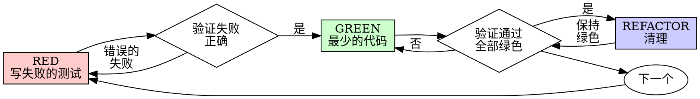

# 测试驱动开发（TDD）

## 概述

先写测试。看它失败。写最少的代码来通过。

**核心原则：** 如果你没有看到测试失败，你就不知道它是否测试了正确的东西。

**违反规则的字面意思就是违反规则的精神。**

## 何时使用

**始终：**
- 新特性
- Bug 修复
- 重构
- 行为更改

**例外（询问你的人类伙伴）：**
- 一次性原型
- 生成的代码
- 配置文件

在想"就这一次跳过 TDD"？停止。那是合理化。

## 铁律

```
没有失败的测试，就没有生产代码
```

在测试之前写代码？删除它。重新开始。

**没有例外：**
- 不要保留它作为"参考"
- 不要在写测试时"适配"它
- 不要看它
- 删除就是删除

从测试开始重新实现。就这样。

## 红-绿-重构



### RED - 写失败的测试

写一个最小的测试，显示应该发生什么。

<Good>
```typescript
test('重试失败的操作 3 次', async () => {
  let attempts = 0;
  const operation = () => {
    attempts++;
    if (attempts < 3) throw new Error('fail');
    return 'success';
  };

  const result = await retryOperation(operation);

  expect(result).toBe('success');
  expect(attempts).toBe(3);
});
```
清晰的名称，测试真实行为，一件事
</Good>

<Bad>
```typescript
test('重试工作', async () => {
  const mock = jest.fn()
    .mockRejectedValueOnce(new Error())
    .mockRejectedValueOnce(new Error())
    .mockResolvedValueOnce('success');
  await retryOperation(mock);
  expect(mock).toHaveBeenCalledTimes(3);
});
```
模糊的名称，测试 mock 而不是代码
</Bad>

**要求：**
- 一个行为
- 清晰的名称
- 真实的代码（除非不可避免，否则不使用 mock）

### 验证 RED - 看它失败

**强制。绝不跳过。**

```bash
npm test path/to/test.test.ts
```

确认：
- 测试失败（不是错误）
- 失败消息是预期的
- 失败是因为功能缺失（不是拼写错误）

**测试通过？** 你在测试现有行为。修复测试。

**测试错误？** 修复错误，重新运行直到它正确失败。

### GREEN - 最少的代码

写最简单的代码来通过测试。好代码的规则见 [writing-good-code.md](writing-good-code.md)。

<Good>
```typescript
async function retryOperation<T>(fn: () => Promise<T>): Promise<T> {
  for (let i = 0; i < 3; i++) {
    try {
      return await fn();
    } catch (e) {
      if (i === 2) throw e;
    }
  }
  throw new Error('unreachable');
}
```
刚好够通过
</Good>

<Bad>
```typescript
async function retryOperation<T>(
  fn: () => Promise<T>,
  options?: {
    maxRetries?: number;
    backoff?: 'linear' | 'exponential';
    onRetry?: (attempt: number) => void;
  }
): Promise<T> {
  // YAGNI
}
```
过度工程
</Bad>

不要添加功能、重构其他代码，或在测试之外"改进"。

### 验证 GREEN - 看它通过

**强制。**

```bash
npm test path/to/test.test.ts
```

确认：
- 测试通过
- 其他测试仍然通过
- 输出干净（没有错误、警告）

**测试失败？** 修复代码，而不是测试。

**其他测试失败？** 现在修复。

**"其他测试"指项目的完整套件，而不仅仅是你的文件。** 你写的测试通过不是整个套件通过。在你声称更改完成之前，运行项目的测试命令（裸 `pytest`、`npm test`、`cargo test` — 无论仓库使用什么），即使你的任务只命名了一个测试文件。任务中的范围声明限制了交付物，而不是你的验证。该运行显示的任何失败 — 包括你没有引起的失败 — 都要按名称报告；你看着红色测试滚动过去而没有提到的，是报告中遗漏的虚假。

### REFACTOR - 清理

仅在绿色之后：
- 删除重复
- 改进名称
- 提取辅助函数

保持测试绿色。不要添加行为。

### 重复

下一个特性的下一个失败测试。

## 好的测试

| 质量 | 好 | 坏 |
|---------|------|-----|
| **最小** | 一件事。名称中有"and"？拆分它。 | `test('验证邮箱、域名和空白')` |
| **清晰** | 名称描述行为 | `test('test1')` |
| **显示意图** | 演示期望的 API | 模糊代码应该做什么 |

在编写或更改任何测试时，阅读 [writing-good-tests.md](writing-good-tests.md) 了解让测试诚实的规则：
- 在写测试之前，命名会使测试失败的生产更改 — 在写之前
- 断言真实行为，而不是 mock 行为
- 将测试专用代码保留在测试工具中，而不是生产类中
- 在 mock 之前理解依赖的副作用

## 好代码

| 质量 | 好 | 坏 |
|---------|------|-----|
| **正确** | 满足测试断言的行为；边界、异常都由测试护住 | "我觉得对"——没有测试支撑的猜测 |
| **最小** | 只实现当前测试要求的行为，一行不多 | 搭完整方案，"反正最终会需要" |
| **可读** | 命名说行为，对齐测试名称里的语言 | `tmp`、`data2`，注释复述"做了什么" |

在编写或更改任何产品代码时，阅读 [writing-good-code.md](writing-good-code.md) 中保持代码克制的规则：
- 每写一段实现，说出它对应哪条断言；说不出来就删掉
- 通用化要等第二个测试来要；只有一个测试时字面量是合法的 GREEN
- 发现相邻的 bug，另写一个测试放进待办，不捎带进当前 diff
- 优化性能之前，先写基准测试，基于测量优化

## 常见合理化

| 借口 | 现实 |
|--------|---------|
| "太简单了不需要测试" | 简单代码也会坏。测试只需 30 秒。 |
| "我稍后测试" | 之后写的测试在通过时立即写 — 这什么也证明不了。它们可能测试错误的东西，测试实现而不是行为，或者漏掉你忘记的边界情况。你从未看到它失败，所以你从未证明它能捕获 bug。测试优先强制那个失败。 |
| "之后测试达到相同目标（精神而非仪式）" | 之后测试回答"这做什么？"；之前测试回答"这应该做什么？"之后写的测试被你已写的代码偏倚 — 你验证你记住的情况，而不是你会发现的情况。没有证明测试工作的覆盖率。 |
| "已经手动测试了" | 手动测试是临时的：没有记录你覆盖了什么，代码更改时无法重新运行，在压力下容易忘记情况。"我试的时候工作" ≠ 全面。自动化测试每次以相同方式运行。 |
| "删除 X 小时的工作是浪费" | 沉没成本谬误 — 那时间无论如何已经花了。真正的选择：用 TDD 重写（高置信度）vs. 保留它并在之后添加测试（低置信度，可能 bug）。保留你无法信任的代码才是浪费。 |
| "保留作为参考，先写测试" | 你会适配它。那是之后测试。删除就是删除。 |
| "需要先探索" | 可以。扔掉探索，从 TDD 开始。 |
| "测试难 = 设计不清晰" | 倾听测试。难测试 = 难使用。 |
| "TDD 会拖慢我" | TDD 是务实的路径：在提交前捕获 bug，防止回归，让你无畏重构。"务实"捷径意味着在生产中调试 — 更慢，不是更快。 |
| "手动测试更快" | 手动不证明边界情况。你每次更改都要重新测试。 |
| "现有代码没有测试" | 你在改进它。为现有代码添加测试。 |

## 红旗 — 停止并重新开始

- 测试之前的代码
- 实现之后的测试
- 测试立即通过
- 无法解释测试为什么失败
- "稍后"添加测试
- 合理化"就这一次"
- "我已经手动测试了"
- "之后测试达到相同目的"
- "这是关于精神而非仪式"
- "保留作为参考"或"适配现有代码"
- "已经花了 X 小时，删除是浪费"
- "TDD 是教条的，我是务实的"
- "这不同，因为..."

**所有这些意味着：删除代码。从 TDD 重新开始。**

## 示例：Bug 修复

**Bug：** 接受空邮箱

**RED**
```typescript
test('拒绝空邮箱', async () => {
  const result = await submitForm({ email: '' });
  expect(result.error).toBe('需要邮箱');
});
```

**验证 RED**
```bash
$ npm test
FAIL: 期望 '需要邮箱'，得到 undefined
```

**GREEN**
```typescript
function submitForm(data: FormData) {
  if (!data.email?.trim()) {
    return { error: '需要邮箱' };
  }
  // ...
}
```

**验证 GREEN**
```bash
$ npm test
PASS
```

**REFACTOR**
如果需要，为多个字段提取验证。

## 验证清单

在标记工作完成之前：

- [ ] 每个新函数/方法都有测试
- [ ] 在实现之前看到每个测试失败
- [ ] 每个测试因预期原因失败（功能缺失，不是拼写错误）
- [ ] 写最少的代码来通过每个测试
- [ ] 所有测试通过
- [ ] 输出干净（没有错误、警告）
- [ ] 测试使用真实代码（仅在不可避免时使用 mock）
- [ ] 边界情况和错误已覆盖

不能勾选所有框？你跳过了 TDD。重新开始。

## 卡住时

| 问题 | 解决方案 |
|---------|----------|
| 不知道如何测试 | 写期望的 API。先写断言。询问你的人类伙伴。 |
| 测试太复杂 | 设计太复杂。简化接口。 |
| 必须 mock 很多东西 | 代码耦合太紧。使用依赖注入。 |
| 测试设置庞大 | 提取辅助函数。仍然复杂？简化设计。 |

## 调试集成

发现 bug？写失败的测试复现它。遵循 TDD 循环。测试证明修复并防止回归。

绝不修复没有测试的 bug。

## 最终规则

```
生产代码 → 测试存在且首先失败
否则 → 不是 TDD
```

没有你的人类伙伴的许可，没有例外。