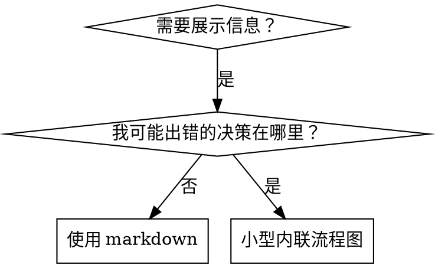

# 技能中的流程图

属于 superpowers:writing-skills 的一部分。

## 流程图使用



**仅在以下情况使用流程图：**
- 非明显的决策点
- 你可能过早停止的流程循环
- "何时使用 A vs B"决策

**永远不要使用流程图用于：**
- 参考材料 → 表格、列表
- 代码示例 → Markdown 块
- 线性指令 → 编号列表
- 没有语义意义的标签（step1、helper2）

参见此目录中的 `graphviz-conventions.dot` 获取 graphviz 样式规则。

**为你的合作伙伴可视化：** 使用 writing-skills 目录中的 `render-graphs.js` 将技能的流程图渲染为 SVG，从那里运行：
```bash
node ./render-graphs.js ../some-skill           # 每个图表单独
node ./render-graphs.js ../some-skill --combine # 所有图表在一个 SVG 中
```